# ShopShere Frontend — Architecture and Runtime Flow

## 1. Architecture at a glance

ShopShere is a browser-rendered React SPA. The frontend owns route selection, rendering, transient form/view state, and presentation. The backend owns persistent products, categories, accounts, cart, and wishlist data.

```mermaid
flowchart TB
    Browser[Browser]
    HTML[index.html]
    Entry[src/main.jsx]
    App[src/App.jsx: BrowserRouter + AuthProvider + routes]
    Nav[Navbar]
    Pages[Route pages]
    Components[Reusable components]
    Context[AuthContext: user and loading]
    Services[Service modules]
    API[api.js: authenticated fetch helper]
    DirectFetch[ProductService and CategoryService fetch]
    Proxy[Vite dev proxy]
    Backend[Backend at localhost:8080]
    CSS[src/index.css + Tailwind classes]

    Browser --> HTML --> Entry --> App
    App --> Nav
    App --> Pages
    Pages --> Components
    Nav --> Context
    Pages --> Context
    Components --> Services
    Pages --> Services
    Services --> API
    Services --> DirectFetch
    API --> Proxy
    DirectFetch --> Proxy
    Proxy --> Backend
    Entry --> CSS
```



### Runtime layers

1. **Document/startup:** `index.html` provides `#root` and loads `src/main.jsx`.
2. **React root:** `main.jsx` imports global CSS and renders `<App />` under `StrictMode`.
3. **Application shell:** `App.jsx` places `BrowserRouter` outside `AuthProvider`, then renders the shared `Navbar` and current route.
4. **View layer:** components and page components render UI and hold local state for their own screens/actions.
5. **Shared identity layer:** `AuthContext.jsx` resolves the existing session during startup and shares user/loading state.
6. **Data-access layer:** service functions translate UI intent into HTTP calls. `api.js` handles auth headers and common errors for authenticated service calls.
7. **Backend transport:** in Vite development, `/api/*` and `/backend/*` are proxied to port `8080` after stripping those prefixes.

## 2. Route architecture

`App.jsx` declares the following paths. The `Navbar` is rendered for all of them.

| URL | Component/rendered screen | Notes |
|---|---|---|
| `/` | Redirect to `/home` | Uses `<Navigate replace />`, so the root is not retained as an extra history entry. |
| `/home` | Local `Home` composition | Renders `Hero`, `Categories`, then `ProductGrid` inside the deals section. |
| `/products` | `pages/Products.jsx` | Optional `category` query parameter; optional router state `{ focusSearch: true }`. |
| `/products/:id` | `pages/ProductDetails.jsx` | `useParams()` supplies `id` to the product service. |
| `/login` | `pages/Login.jsx` | Sign-in form and current-user loading. |
| `/register` | `pages/Register.jsx` | Registration form. |
| `/profile` | `pages/Profile.jsx` | Shows profile or a signed-out prompt. |
| `/wishlist` | `pages/Wishlist.jsx` | Loads the account's saved products. |
| `/cart` | `pages/Cart.jsx` | Loads and mutates the account's cart. |

There is no route-level authentication guard in the router. Protected-data requests and some navbar actions handle missing/invalid auth at the screen/action level by displaying a message or routing to login.

## 3. Component tree and ownership

```text
main.jsx
└── App
    └── BrowserRouter
        └── AuthProvider
            ├── Navbar (shared across all routes)
            └── Routes
                ├── /home -> Home
                │   ├── Hero
                │   ├── Categories
                │   └── ProductGrid
                │       └── ProductCard (one per trending product)
                ├── /products -> Products
                │   └── ProductCard (one per filtered product)
                ├── /products/:id -> ProductDetails
                ├── /login -> Login
                ├── /register -> Register
                ├── /profile -> Profile
                ├── /wishlist -> Wishlist
                └── /cart -> Cart
```

`Products` and `ProductGrid` pass product records into `ProductCard` through the `product` prop. `AuthProvider` owns user identity state; product/cart/wishlist records are otherwise held by the pages/components that fetch them.

## 4. Startup and authentication flow

### Initial page load

1. The browser parses `index.html`, creates `#root`, and loads `src/main.jsx`.
2. `main.jsx` imports `index.css`, creates the React root, and renders `App` in `StrictMode`.
3. `App` creates the router and mounts `AuthProvider` around the shared navbar and route tree.
4. `AuthProvider` begins with `loading=true`; its effect calls `getToken()` from `AuthService`.
5. With no token, auth loading ends and `user` remains `null`. With a token, it calls `getCurrentUser()`.
6. `getCurrentUser()` calls `apiRequest('/auth/me')`. `apiRequest` reads the token from local storage, adds `Authorization: Bearer ...`, and sends `GET /api/auth/me`.
7. A successful current-user response populates context `user`; a failed response invokes `logoutService()` (clearing the token) and leaves `user` null. In either case, loading becomes false.
8. `Navbar`, `Profile`, and other `useAuth()` consumers re-render from the shared context value.

### Sign in

```mermaid
sequenceDiagram
    actor User
    participant Login as Login.jsx
    participant Auth as AuthService.js
    participant API as api.js
    participant Backend
    participant Context as AuthContext
    participant Router as React Router

    User->>Login: Submit email/password
    Login->>Login: preventDefault; clear error; set loading
    Login->>Auth: login(email, password)
    Auth->>API: POST /auth/login with JSON body
    API->>Backend: POST /api/auth/login
    Backend-->>API: response JSON including token
    API-->>Auth: parsed data
    Auth->>Auth: verify token; save shopshere_token in localStorage
    Auth-->>Login: login response
    Login->>Auth: getCurrentUser()
    Auth->>API: GET /auth/me
    API->>Backend: GET /api/auth/me with bearer token
    Backend-->>API: current user JSON
    API-->>Login: current user
    Login->>Context: setUser(currentUser)
    Login->>Router: navigate('/home', replace)
```

If login or current-user retrieval throws, `Login` displays the error and clears its loading state in `finally`. Registration follows a separate path: `Register.handleSubmit` calls `AuthService.register`, then navigates to `/login` with a success message in router state; the current login screen does not yet display that state message.

### Sign out

`Profile.handleLogout()` calls the `logout` function from `AuthContext`; that calls `AuthService.logout()` to remove `shopshere_token` from local storage and sets context `user` to null. Profile then navigates to `/login` with history replacement.

## 5. Page and action flows

### Home page and category listing

- `Home` in `App.jsx` renders sections in order: `Hero`, `Categories`, and trending `ProductGrid`.
- `Hero` is presentational. Its product links route to `/products`; its image source passes through `getImageUrl`.
- On mount, `Categories` calls `getCategories()` and `getProducts()` together through `Promise.allSettled`.
  - Fulfilled category data is filtered to retain records that exist and are not explicitly inactive (`active !== false`).
  - Fulfilled product data is filtered using the same active rule.
  - For each category, it counts products whose `product.category` exactly matches `category.name`.
  - Clicking a category goes to `/products?category=<URL-encoded name>`.
- On mount, `ProductGrid` calls `getProducts()`, filters to `active === true && trending === true`, then renders a `ProductCard` for each product. Its "View All Products" link routes to `/products`.

### Product browsing, search, filtering, and sorting

1. `Products` calls `ProductService.getProducts()` once when mounted.
2. On success it keeps products where `active` is truthy; on failure it shows an error; the `finally` callback ends the loading state.
3. Unique category options are derived using `Set` over the loaded products' category names.
4. The visible list is derived from a copied array (`[...products]`):
   - When the trimmed search input is nonempty, name or brand must contain the lowercased search phrase.
   - When category is not `All`, the product category must equal the selected category.
   - Depending on sort state, the copied result is sorted by price ascending, price descending, or name ascending with `localeCompare`.
5. Category selection updates both local category state and the URL query parameter. Selecting `All` deletes `category`; other values set it. The change uses `replace: true` rather than adding a browser-history entry.
6. When navigation state contains `focusSearch`, an effect focuses the input via `useRef`.
7. Each visible product is passed to `ProductCard`. Its title/image links to `/products/:id`.

The category is read from the query string to initialize local state when `Products` mounts. Subsequent select changes write back to the query string.

### Product card: wishlist and cart actions

**Wishlist status and toggle**

- When `ProductCard` mounts/receives a new product ID, an effect checks for a token in `sessionStorage`. If absent, it skips the initial wishlist request.
- If the check passes, `getWishlist()` calls the wishlist API through `apiRequest`; the component uses `some()` to check whether an entry's nested `product.id` matches the card's product ID.
- Clicking the heart prevents default link behavior and stops event propagation. If no session-storage token is detected, it navigates to `/login`.
- Otherwise it calls `removeFromWishlist(product.id)` if already saved, or `addToWishlist(product.id)` if not; local heart state changes on success. A 401 routes to login; other failures render an error message.

**Add to cart**

- Clicking the add button also prevents default and propagation.
- If there is no token in `sessionStorage`, it navigates to `/login`.
- Otherwise it calls `addCartItem(product.id, 1)`, which posts JSON to `/api/cart/items` through `apiRequest`.
- The button reports progress, success, or failure; 401 routes to login. The button is disabled for out-of-stock products or during the request.

### Product detail and add-to-cart flow

1. Router matches `/products/:id`; `ProductDetails` reads the ID with `useParams()`.
2. Its effect calls `getProductById(id)`. Changing `id` causes a new request. The UI shows loading, product data, or not-found UI depending on the result.
3. The details view derives stock messaging from `stockQuantity`: zero is out of stock, up to ten is low stock, otherwise in stock.
4. On add-to-cart, `handleAddToCart()` converts the input to `Number` and rejects non-integers or values less than one.
5. It checks `sessionStorage` for the token; absent token routes to login. Otherwise it calls `addCartItem(product.id, requestedQuantity)` and displays success/error feedback.
6. The backend's response is authoritative for stock and cart acceptance. The UI's max quantity is an input hint, not a substitute for backend validation.

The details-page heart icon has no handler in the current implementation, so it does not initiate a wishlist call.

### Wishlist page

1. On mount, `Wishlist` calls `WishlistService.getWishlist()`.
2. It accepts an array response directly or reads `items`/`content` from an object response.
3. Each entry is normalized to `entry.product || entry`; records without an ID are discarded.
4. A remove click marks that product as removing, calls `removeFromWishlist(product.id)`, and on success removes it from the local product array using `filter`.
5. Errors are displayed; a 401 gets a sign-in-again message. The page supports loading, empty, and populated states, with product links to details.

### Cart page and mutations

```mermaid
sequenceDiagram
    actor User
    participant CartPage as Cart.jsx
    participant CartService
    participant API as api.js
    participant Backend

    User->>CartPage: Open /cart
    CartPage->>CartService: getCart()
    CartService->>API: GET /cart
    API->>Backend: GET /api/cart + bearer token if available
    Backend-->>CartPage: cart data
    CartPage->>CartPage: normalize items; render totals/items
    User->>CartPage: Increase/decrease quantity or remove item
    CartPage->>CartService: updateCartItem(id, quantity) OR removeCartItem(id)
    CartService->>API: PATCH /cart/items/{id} OR DELETE /cart/items/{id}
    API->>Backend: authenticated request
    Backend-->>CartPage: mutation response
    CartPage->>CartService: getCart() via refreshCart()
    CartService->>API: GET /cart
    API->>Backend: reload current cart
    Backend-->>CartPage: refreshed cart data
    CartPage->>CartPage: replace local cart state
```

Detailed behavior:

- Initial effect requests `getCart()`, normalizes `items` to an array, and uses a cancellation flag so a completed request does not update state after unmount.
- Missing server aggregates are calculated: `totalItems` is the sum of `item.quantity`; `totalAmount` is the sum of numeric `item.subtotal` values.
- Quantity decrement is blocked below one and at the UI level when another item mutation is busy. Quantity increment/decrement calls `updateCartItem(item.id, quantity)`.
- Remove calls `removeCartItem(itemId)`.
- After either successful mutation, `refreshCart()` fetches the server cart again, keeping the backend response as the source of truth.
- Errors are shown inline. A 401 asks the user to sign in; the alert includes a `/login` link when the text mentions sign-in.
- Checkout is not wired to a service and its button is disabled.

## 6. Service call map and backend URLs

| UI caller | Service function(s) | HTTP path/method | Transport helper |
|---|---|---|---|
| `Categories` | `getCategories` | `GET /api/category` | Direct `fetch` in `CategoryService.js` |
| `Categories`, `ProductGrid`, `Products` | `getProducts` | `GET /api/product` | Direct `fetch` in `ProductService.js` |
| `ProductDetails` | `getProductById(id)` | `GET /api/product/{id}` | Direct `fetch` in `ProductService.js` |
| `Login` | `login`, `getCurrentUser` | `POST /api/auth/login`, then `GET /api/auth/me` | `AuthService.js` through `apiRequest` |
| `Register` | `register` | `POST /api/auth/register` | `AuthService.js` through `apiRequest` |
| `AuthProvider` | `getToken`, `getCurrentUser`, `logout` | Local storage read/clear; `GET /api/auth/me` if token exists | Auth service and `apiRequest` |
| `ProductCard` | `getWishlist`, `addToWishlist`, `removeFromWishlist` | `GET /api/wishlist`; `POST`/`DELETE /api/wishlist/{productId}` | `WishlistService.js` through `apiRequest` |
| `Wishlist` | `getWishlist`, `removeFromWishlist` | `GET /api/wishlist`; `DELETE /api/wishlist/{productId}` | `WishlistService.js` through `apiRequest` |
| `ProductCard`, `ProductDetails` | `addCartItem` | `POST /api/cart/items` with `{ productId, quantity }` | `CartService.js` through `apiRequest` |
| `Cart` | `getCart`, `updateCartItem`, `removeCartItem` | `GET /api/cart`; `PATCH /api/cart/items/{itemId}`; `DELETE /api/cart/items/{itemId}` | `CartService.js` through `apiRequest` |

In Vite development, the browser calls same-origin paths. `vite.config.js` proxies `/api` and `/backend` to `http://localhost:8080` and rewrites each path by removing its prefix. For example, the browser request `/api/auth/me` is forwarded as `/auth/me`; `/backend/images/Hero/hero.jpg` is forwarded as `/images/Hero/hero.jpg`. This proxy is specifically the Vite server's development configuration.

`apiRequest` reads `shopshere_token` from `localStorage`, sets `Authorization: Bearer <token>` when present, sets JSON content type when a request body exists, and parses errors into `Error` objects with a `status` property. Product/category fetch wrappers do not use `apiRequest` and return generic errors.

## 7. Cross-cutting state, errors, and images

- **Auth context:** `user` and its startup `loading` flag are shared. It is not used as a general storage mechanism for page data.
- **Page data:** components use local `useState`; remounting a page may refetch its data.
- **Loading/error/empty states:** catalogue, category, product, cart, wishlist, auth forms and cards each handle relevant request states locally; consistency and wording are owned by each component.
- **Image selection:** product/category components pass backend image paths to `getImageUrl`. Full `http...` URLs pass through, relative paths are prefixed with `/backend`, and missing image values map to `/placeholder-product.png`.
- **Navigation state:** navbar section navigation carries `scrollTo`; search navigation carries `focusSearch`; registration carries a `message`. The products page consumes `focusSearch`; the home-section `scrollTo` state is not consumed by the current `Home` implementation, and the login page does not currently render the registration message.

## 8. Current flow caveats reflected by the code

- `AuthService` and `apiRequest` use `localStorage`, but `ProductCard` and `ProductDetails` gate actions using `sessionStorage`. A token saved by login is not automatically copied between these stores; therefore a signed-in user can encounter a UI login redirect from those components even though the API helper can see a local-storage token. Navbar checks the shared `user`, not either storage API.
- Wishlist response handling is not identical everywhere: `Wishlist.jsx` tolerates array, `items`, or `content` shapes, while `ProductCard` expects the result of `getWishlist()` to have `.some()` and each matching entry to expose `product.id`.
- Category selection initializes from the URL query on mount; the screen's select handler updates both state and URL. A subsequent external query-only navigation while the component remains mounted is not explicitly synchronized back into category state.
- Product detail wishlist and checkout are not functional flows yet; their current controls do not invoke backend operations.
- The Vite proxy target and backend image routes presume a backend service available on `localhost:8080` during development. Production hosting needs equivalent API and image routing.
